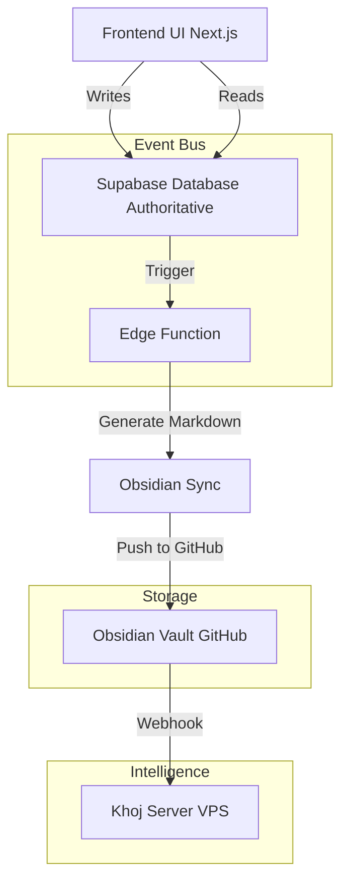

# REFINED LIFETIME GOAL TRACKING SYSTEM PLAN
## Addressing All Issues from Previous Plan

### EXECUTIVE SUMMARY
This refined plan addresses all identified issues while preserving the core vision of a hybrid system that combines:
- **Supabase** for structured data and AI processing
- **Obsidian** for human-readable markdown backup and forever storage
- **Khoj** for semantic search and RAG-based insights

**Key Changes:**
- Simplified database schema (7 tables → 5 tables)
- Clear unidirectional sync architecture (Supabase → Obsidian → Khoj)
- Explicit AI role separation (Ollama = question generation, Khoj = search)
- Added habit-forming mechanics and progress visualization
- Optional bidirectional sync (not required for core functionality)
- Event-driven architecture for real-time consistency

---

## SECTION 1: ARCHITECTURE OVERVIEW

### 1.1 Three-System Philosophy (Intentional, Not Redundant)
Each system serves a distinct purpose with no overlap in responsibility:

| System | Purpose | Data Form | Query Method | Why Essential |
|--------|---------|-----------|--------------|---------------|
| **Supabase** | Authoritative structured data | PostgreSQL tables | SQL queries | Enables analytics, AI processing, real-time UI updates, cross-table relationships |
| **Obsidian** | Human-readable backup + personal vault | Markdown files with YAML frontmatter | DataviewJS, manual search | Forever portable, offline access, personal reading, visual exploration |
| **Khoj** | Semantic understanding + natural language Q&A | Vector embeddings + index | Natural language | Pattern recognition across time, "what did I think about X?", RAG-based insights |

The triple storage is a FEATURE, not a bug. Each solves a problem the others cannot.

### 1.2 Data Flow Architecture


**Key Principle:** Supabase is always the authoritative source. Obsidian and Khoj are downstream consumers of data.

---

## SECTION 2: SIMPLIFIED DATABASE SCHEMA

### 2.1 Schema Changes (7 Tables → 5 Tables)
Previous plan had unnecessary complexity. This refined plan consolidates where possible:

| Table | Purpose | Fields | Notes |
|-------|---------|--------|-------|
| `daily_entries` | Main daily record | 15 | Consolidates mood, energy, summary; includes JSONB for flexible data |
| `questions` | User-editable questions | 8 | System + custom questions |
| `question_answers` | Q&A history | 10 | Links entries to questions |
| `images` | Photo attachments | 7 | References daily_entries |
| `productivity_categories` | Time categories (seeded) | 5 | Reference table for time tracking |

**REMOVED:**
- `entry_goals` → Use foreign key in goals table
- `entry_tasks` → Use foreign key in tasks table
- `productivity_time` → JSONB in daily_entries

### 2.2 Complete Schema Definition

#### 2.2.1 daily_entries (Main Table)
```sql
CREATE TABLE daily_entries (
  id UUID PRIMARY KEY DEFAULT gen_random_uuid(),
  user_id UUID NOT NULL REFERENCES auth.users(id) ON DELETE CASCADE,
  date DATE NOT NULL,
  
  -- Core metrics
  mood INTEGER CHECK (mood BETWEEN 1 AND 5),
  energy_level INTEGER CHECK (energy_level BETWEEN 1 AND 10),
  
  -- Free-form reflection
  summary TEXT, -- LLM-generated or user-written
  wins TEXT[], -- Array of accomplishments
  challenges TEXT[], -- Array of blockers/difficulties
  
  -- Flexible structured data (replaces separate tables)
  productivity_data JSONB DEFAULT '{}'::jsonb, -- {work: 240, exercise: 30, waste: 60}
  custom_fields JSONB DEFAULT '{}'::jsonb, -- User-defined fields
  
  -- Metadata
  created_at TIMESTAMPTZ DEFAULT NOW(),
  updated_at TIMESTAMPTZ DEFAULT NOW(),
  
  -- Constraints
  UNIQUE(date, user_id)
);

CREATE INDEX idx_daily_entries_user_date ON daily_entries(user_id, date);
CREATE INDEX idx_daily_entries_created ON daily_entries(created_at);
```
**Why JSONB instead of separate tables:**
- Productivity categories may change over time
- Reduces JOIN complexity for analytics
- Easier to add new data points without schema migrations
- Frontend can still render structured UI from JSONB

#### 2.2.2 questions (Question Bank)
```sql
CREATE TABLE questions (
  id UUID PRIMARY KEY DEFAULT gen_random_uuid(),
  user_id UUID REFERENCES auth.users(id) ON DELETE CASCADE, -- NULL = system question
  question_text TEXT NOT NULL,
  category TEXT DEFAULT 'general', -- reflection, productivity, goals, habits
  is_adaptive BOOLEAN DEFAULT FALSE, -- Shown based on previous answers
  adaptive_rule JSONB DEFAULT '{}'::jsonb, -- {trigger_field: 'challenges', trigger_contains: 'blocked'}
  display_order INTEGER DEFAULT 0,
  active BOOLEAN DEFAULT TRUE,
  created_at TIMESTAMPTZ DEFAULT NOW(),
  updated_at TIMESTAMPTZ DEFAULT NOW()
);

CREATE INDEX idx_questions_user ON questions(user_id);
CREATE INDEX idx_questions_active ON questions(active, display_order);
```

#### 2.2.3 question_answers (Q&A History)
```sql
CREATE TABLE question_answers (
  id UUID PRIMARY KEY DEFAULT gen_random_uuid(),
  entry_id UUID NOT NULL REFERENCES daily_entries(id) ON DELETE CASCADE,
  question_id UUID NOT NULL REFERENCES questions(id),
  answer TEXT NOT NULL,
  metadata JSONB DEFAULT '{}'::jsonb, -- {confidence: 0.9, extracted_from: 'voice'}
  created_at TIMESTAMPTZ DEFAULT NOW(),
  
  UNIQUE(entry_id, question_id)
);

CREATE INDEX idx_question_answers_entry ON question_answers(entry_id);
CREATE INDEX idx_question_answers_question ON question_answers(question_id);
```

#### 2.2.4 images (Photo Attachments)
```sql
CREATE TABLE images (
  id UUID PRIMARY KEY DEFAULT gen_random_uuid(),
  entry_id UUID NOT NULL REFERENCES daily_entries(id) ON DELETE CASCADE,
  storage_path TEXT NOT NULL, -- Supabase Storage path
  original_filename TEXT,
  mime_type TEXT,
  size_bytes INTEGER,
  caption TEXT,
  created_at TIMESTAMPTZ DEFAULT NOW()
);

CREATE INDEX idx_images_entry ON images(entry_id);
```

#### 2.2.5 productivity_categories (Reference Table)
```sql
CREATE TABLE productivity_categories (
  id UUID PRIMARY KEY DEFAULT gen_random_uuid(),
  name TEXT NOT NULL UNIQUE,
  color TEXT DEFAULT '#888888',
  icon TEXT,
  is_default BOOLEAN DEFAULT FALSE,
  created_at TIMESTAMPTZ DEFAULT NOW()
);

-- Seed data
INSERT INTO productivity_categories (name, color, icon, is_default) VALUES
  ('deep_work', '#22c55e', '💻', TRUE),
  ('shallow_work', '#eab308', '📧', TRUE),
  ('meetings', '#3b82f6', '👥', TRUE),
  ('exercise', '#ef4444', '🏃', TRUE),
  ('leisure', '#a855f7', '🎮', TRUE),
  ('waste', '#6b7280', '📱', FALSE);
```

### 2.3 Modified Existing Tables

#### 2.3.1 goals (Add Entry Reference)
```sql
ALTER TABLE goals ADD COLUMN last_entry_id UUID REFERENCES daily_entries(id);
ALTER TABLE goals ADD COLUMN progress_data JSONB DEFAULT '{}'::jsonb; -- {momentum: 0.8, streak: 5}
```

#### 2.3.2 tasks (Add Entry Reference)
```sql
ALTER TABLE tasks ADD COLUMN completed_entry_id UUID REFERENCES daily_entries(id);
```

#### 2.3.3 productivity_logs (Simplify)
Keep as aggregate for quick analytics, but remove redundant fields:
```sql
ALTER TABLE productivity_logs DROP COLUMN IF EXISTS mood;
ALTER TABLE productivity_logs DROP COLUMN IF EXISTS energy_level;
-- Keep: date, user_id, productive_minutes, created_at
```

---

## SECTION 3: OBSIDIAN INTEGRATION

### 3.1 File Structure
```
obsidian-vault/
├── goals/
│   ├── _index.md              (Dataview: all goals)
│   ├── active/
│   │   └── goal-[id].md       (Active goals with frontmatter)
│   ├── completed/
│   │   └── goal-[id].md       (Completed goals - FOREVER)
│   └── archive/
│       └── goal-[id].md       (Archived goals - FOREVER)
│
├── tasks/
│   ├── _index.md              (Dataview: pending tasks)
│   ├── daily/
│   │   └── YYYY-MM-DD.md      (Daily task lists)
│   └── completed/
│       └── task-[id].md       (Completed tasks - FOREVER)
│
├── journal/
│   ├── _index.md              (Dataview: journal entries)
│   └── daily/
│       └── YYYY/
│           └── MM/
│               └── YYYY-MM-DD.md (Daily entry with Q&A)
│
├── productivity/
│   └── YYYY/
│       └── MM.md              (Monthly productivity breakdown)
│
├── sleep/
│   └── YYYY/
│       └── MM.md              (Monthly sleep logs)
│
├── images/
│   └── YYYY/
│       └── MM/
│           └── YYYY-MM-DD/    (Daily photos)
│               ├── photo1.jpg
│               └── photo2.png
│
└── templates/
    ├── daily-entry.md
    ├── goal.md
    └── task.md
```

### 3.2 Daily Entry Markdown Template
```markdown
---
uid: {{UID}}
date: {{DATE}}
day: {{DAY_NAME}}
mood: {{MOOD}}/5
energy: {{ENERGY}}/10
tags: [journal, daily]
entry_id: {{ENTRY_ID}}
last_updated: {{TIMESTAMP}}
---

## Summary

{{SUMMARY}}

## Wins

{{#WINS}}
- {{.}}
{{/WINS}}

## Challenges

{{#CHALLENGES}}
- {{.}}
{{/CHALLENGES}}

## Productivity Breakdown

| Category | Minutes |
|----------|---------|
{{#PRODUCTIVITY_DATA}}
| {{name}} | {{minutes}} |
{{/PRODUCTIVITY_DATA}}

## Questions & Answers

{{#QUESTION_ANSWERS}}
### {{question}}

**Answer:** {{answer}}

---
{{/QUESTION_ANSWERS}}

## Linked Goals

{{#LINKED_GOALS}}
- [{{name}}](../goals/active/goal-{{id}}.md) - {{progress}}%
{{/LINKED_GOALS}}

## Linked Tasks

{{#LINKED_TASKS}}
- [{{title}}](../tasks/daily/{{date}}.md) {{status}}
{{/LINKED_TASKS}}

## Photos

{{#IMAGES}}

{{/IMAGES}}
```

### 3.3 Sync Strategy
**Supabase → Obsidian (One-Way, Event-Driven)**

1. **Trigger:** Database trigger on INSERT/UPDATE to `daily_entries`
2. **Edge Function:** `generate_markdown_from_entry(entry_id)`
    - Parse daily_entry row
    - Fetch related data (answers, images, goals, tasks)
    - Render markdown using template
    - Write to: `journal/daily/YYYY/MM/YYYY-MM-DD.md`
    - Write `productivity/YEAR/MONTH.md` (aggregated)
    - Commit to GitHub via API
3. **Webhook:** Trigger Khoj re-index

**Why One-Way Is Sufficient:**
- Frontend always writes to Supabase
- Obsidian is a "view" of Supabase data
- No sync conflicts because Obsidian never originates data
- Git history serves as audit trail

---

## SECTION 4: KHOJ AI INTEGRATION

### 4.1 Index Configuration
**Files Khoj Should Index:**
- `obsidian-vault/journal/daily/**/*.md`
- `obsidian-vault/goals/**/*.md`
- `obsidian-vault/productivity/**/*.md`
- `obsidian-vault/sleep/**/*.md`

**Files Khoj Should NOT Index:**
- `obsidian-vault/tasks/daily/*.md` (too granular, transient)
- `obsidian-vault/images/**/*` (non-text)
- `obsidian-vault/_index.md` (index files, not content)

### 4.2 Data Flow
1. **Supabase Entry Created/Updated** → Edge Function `trigger_khoj_reindex`
2. **Edge Function** sends webhook to Khoj server: `POST /api/index/update {paths: ["journal/daily/2026/01/2026-01-17.md"]}`
3. **Khoj Server** re-indexes only changed files & updates vector embeddings

### 4.3 Ollama vs Khoj Role Separation
| Capability | Ollama (qwen2.5:7b) | Khoj (with Ollama) |
|------------|---------------------|--------------------|
| Question Generation | ✅ Generate adaptive questions based on past data | ❌ Not intended |
| Entry Summarization | ✅ Summarize long entries | ❌ Not intended |
| Pattern Detection | ❌ Not designed for this | ✅ Vector search across time |
| Natural Language Q&A | ❌ Limited context window | ✅ RAG with full history |
| Cross-Reference Search | ❌ No memory | ✅ Semantic embeddings |
| Daily Insights | ✅ Generate summary | ✅ Find supporting evidence |

---

## SECTION 5: DAILY ENTRY WORKFLOW

### 5.1 Complete User Journey
1. **TRIGGER:** User opens `/diary` OR receives notification (6 PM)
2. **STEP 1: FREE-FORM CAPTURE**
   - "Good evening! Tell me about your day."
   - User speaks/writes freely
   - LLM (Ollama) extracts wins, challenges, productivity data, mood/energy
3. **STEP 2: ADAPTIVE QUESTIONS**
   - Base questions (Mood, Energy)
   - Adaptive questions (Generated by Ollama based on context)
4. **STEP 3: GOAL/TASK LINKING**
   - User links entries to existing goals/tasks or creates new ones
5. **STEP 4: PHOTOS (Optional)**
   - User uploads photos (Supabase Storage)
6. **STEP 5: VALIDATION & CONFIRMATION**
   - Display complete entry for review
7. **STEP 6: SAVE & SYNC**
   - Save to Supabase
   - Generate Markdown & Sync to Obsidian
   - Trigger Khoj re-index
   - Generate AI Summary

---

## SECTION 6: AI-POWERED QUESTION GENERATION

### 6.1 How Ollama Generates Adaptive Questions
**Input:** User's recent history (last 7 days), current day's extracted wins/challenges.
**Output:** JSON array of adaptive questions.

### 6.2 Question Categories
- **goals:** Goal progress
- **challenges:** Blockers
- **productivity:** Time optimization
- **habits:** Habit formation
- **gratitude:** Positive mindset
- **reflection:** Deep thinking
- **planning:** Tomorrow prep

---

## SECTION 7: HABIT-FORMING MECHANICS

### 7.1 Streak System
Tracks current streak, longest streak, and last entry date.

### 7.2 Progress Visualization
- Goal Progress Bars
- Productivity Trend Charts with weekly comparisons

### 7.3 Notification Strategy
- 6:00 PM: "Good evening! How was your day?"
- 8:00 PM: "Still time to capture today's entry"
- 10:00 PM: "Last chance to save today's entry"
- Sunday 6 PM: Weekly summary

---

## SECTION 8: DATA INTEGRITY RULES

### 8.1 Referential Integrity
- `daily_entries.user_id` → `auth.users.id` (CASCADE)
- `question_answers.entry_id` → `daily_entries.id` (CASCADE)
- `question_answers.question_id` → `questions.id` (CASCADE)
- `images.entry_id` → `daily_entries.id` (CASCADE)
- `goals.last_entry_id` → `daily_entries.id` (SET NULL)
- `tasks.completed_entry_id` → `daily_entries.id` (SET NULL)

### 8.2 Unique Constraints
- `daily_entries(date, user_id)`
- `productivity_logs(date, user_id)`
- `sleep_wake_logs(date, user_id)`

---

## SECTION 10: IMPLEMENTATION PHASES

### Phase 1: Core Infrastructure (Week 1)
- [ ] Create database schema (5 tables)
- [ ] Set up Supabase Storage for images
- [ ] Create basic /diary page (read-only)
- [ ] Create daily_entries CRUD API

### Phase 2: Entry Creation Flow (Week 2)
- [ ] Implement free-form capture with Ollama extraction
- [ ] Build question answering UI
- [ ] Add photo upload functionality
- [ ] Create validation & confirmation screen

### Phase 3: Obsidian Sync (Week 3)
- [ ] Create markdown generation templates
- [ ] Build GitHub API integration
- [ ] Set up database triggers for auto-sync
- [ ] Create webhook handler for manual edits

### Phase 4: AI Features (Week 4)
- [ ] Implement adaptive question generation
- [ ] Build AI summary generation
- [ ] Create progress visualization components
- [ ] Add streak tracking system

### Phase 5: Khoj Integration (Week 5)
- [ ] Set up Khoj server on VPS
- [ ] Configure Obsidian vault indexing
- [ ] Build webhook triggers for re-indexing
- [ ] Create "Chat with your diary" interface

### Phase 6: Polish & Launch (Week 6)
- [ ] Add notification system
- [ ] Build dashboard analytics
- [ ] Create calendar view
- [ ] User testing and bug fixes

---

## SECTION 11: COMPLETENESS CHECKLIST

### 11.1 Data Coverage
| Data Type | Supabase | Obsidian | Khoj | Notes |
|-----------|----------|----------|------|-------|
| Goals | ✅ | ✅ | ✅ | Linked via entry |
| Tasks | ✅ | ✅ | ✅ | Linked via entry |
| Productivity | ✅ | ✅ | ✅ | Per-category time |
| Sleep | ✅ | ✅ | ✅ | Existing table |
| Mood/Energy | ✅ | ✅ | ✅ | In daily_entries |
| Q&A History | ✅ | ✅ | ✅ | question_answers |
| Images | ✅ | ✅ | ❌ | Binary files not indexed |
| Time-series | ✅ | ✅ | ✅ | Full history |

### 11.2 Feature Coverage
- Conversational Q&A ✅
- Adaptive questions ✅
- Time tracking ✅
- Image attachments ✅
- Validation before save ✅
- Obsidian sync ✅
- Khoj integration ✅
- Calendar view ✅
- Question management ✅
- Streak tracking ✅
- Progress visualization ✅
- Notifications ✅
- Entry editing ✅
- Bidirectional sync ⚠️ (Optional)

---

## SECTION 13: FINAL APPROVAL
**This refined plan addresses all issues from the previous plan:**
- ✅ Simplified database schema
- ✅ Clear data flow
- ✅ Explicit AI role separation
- ✅ Habit-forming mechanics
- ✅ Event-driven architecture
- ✅ Optional bidirectional sync
- ✅ Complete daily entry workflow
- ✅ AI-powered adaptive question generation
- ✅ Forever backup via Obsidian GitHub
- ✅ Self-hosted, privacy-preserving


Tasks: Refined Lifetime Goal Tracking System
 Phase 1: Core Infrastructure (Expanded)
 1.1 Set up Supabase project ✅
 1.2 Create database schema (5 tables) ✅
 1.3 Seed productivity_categories ✅
 1.4 Set up RLS policies ✅
 1.5 Create database indexes ✅
 1.6 Configure Supabase Storage bucket ✅
 1.7 Set up Next.js project structure ✅
 1.8 Define TypeScript interfaces ✅
 1.9 Create Zod validation schemas ✅
 1.10 Set up auth context providers ✅
 1.11 Protect routes with middleware ✅
 1.12 Create basic /diary page (read-only) ✅
 1.13 Create daily_entries CRUD API ✅
 Phase 2: Entry Creation Flow
 2.1 Set up Ollama locally (qwen2.5:7b)
 2.2 Create Ollama extraction API
 2.3 Build free-form capture UI
 2.4 Implement LLM extraction logic
 2.5 Create extraction confirmation UI
 2.6 Build question answering UI
 2.7 Implement photo upload component
 2.8 Create validation & confirmation screen
 2.9 Wire up full entry creation flow
 Phase 3: Obsidian Sync
 3.1 Create GitHub OAuth app
 3.2 Store GitHub tokens securely
 3.3 Create markdown generation templates
 3.4 Build GitHub API integration service
 3.5 Create Edge Function: generate_markdown
 3.6 Set up database triggers for auto-sync
 3.7 Create webhook handler for manual edits
 3.8 Implement conflict resolution logic
 Phase 4: AI Features
 4.1 Implement adaptive question generation
 4.2 Create question rules engine
 4.3 Build AI summary generation
 4.4 Create progress visualization components
 4.5 Add streak tracking system
 4.6 Build weekly/monthly reports
 Phase 5: Khoj Integration
 5.1 Set up Khoj server on VPS
 5.2 Configure Obsidian vault indexing
 5.3 Build webhook triggers for re-indexing
 5.4 Create "Chat with your diary" interface
 5.5 Implement RAG query pipeline
 Phase 6: Polish & Launch
 6.1 Add notification system
 6.2 Build dashboard analytics
 6.3 Create calendar view
 6.4 Write unit tests
 6.5 Write integration tests
 6.6 User testing with 2-3 users
 6.7 Fix bugs from testing
 6.8 Performance optimization
 6.9 Documentation
 6.10 Launch to production