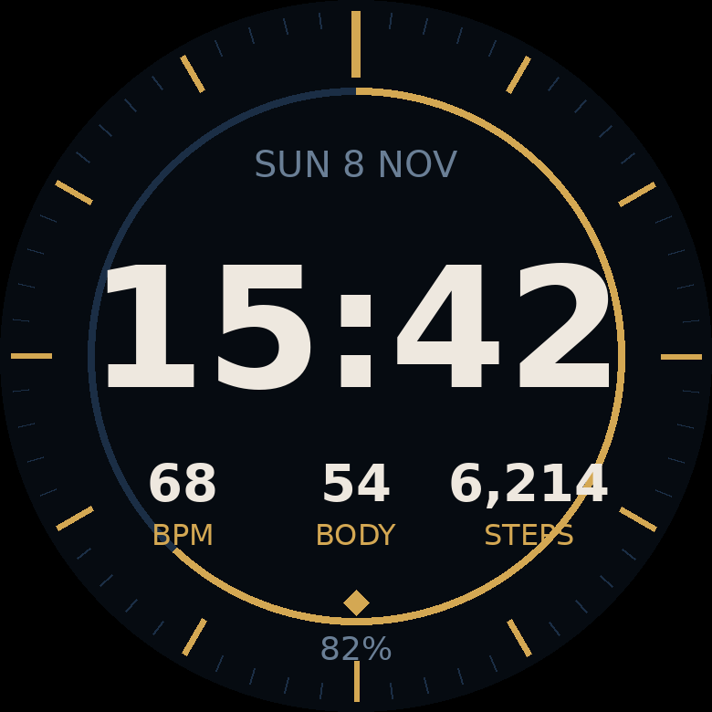

# Goal Tracker watch face (vívoactive 5)

Time, date, heart rate, Body Battery, steps (gold ring = progress to step goal),
battery, and a gold diamond that lights up when the last data sync to the
Goal Tracker app succeeded. It also sends sensor data to the app every
5 minutes, so you don't need the separate `garmin-watch` app for syncing.

Between the date and the time it shows the **next routine task** ("14:30 Stretch",
fetched from `/api/watch/tasks` in the same 5-minute background sync); a gold dot
in front means it is due now. Watch faces can't buzz or open apps from the
background, so for vibration and Done / Snooze / Skip install the
`garmin-watch` app too (both can run side by side).

## Option A — on the watch today, phone only (Face It)
`faceit-background.png` is a 390×390 background in the same style.
1. AirDrop / save `faceit-background.png` to your iPhone's Photos.
2. Connect IQ app → **Face It** tab → **+** → pick the photo.
3. Choose a digital time style, save, and it installs to the watch.
(Garmin draws the time itself here; the data and sync need option B.)

## Option B — full custom face (computer + USB once)
1. Connect IQ SDK Manager → sign in → install SDK and the **vívoactive 5** device.
2. `cp ../garmin-shared/Config.mc.example ../garmin-shared/Config.mc` and set
   `INGEST_KEY` to `WATCH_INGEST_KEY` from Vercel.
3. Developer key (once):
   `openssl genrsa -out developer_key.pem 4096 && openssl pkcs8 -topk8 -inform PEM -outform DER -in developer_key.pem -out developer_key.der -nocrypt`
4. `monkeyc -d vivoactive5 -f monkey.jungle -o bin/GoalTrackerFace.prg -y developer_key.der`
5. Plug in the watch, copy `bin/GoalTrackerFace.prg` into `GARMIN/APPS/`
   (macOS: use the free OpenMTP app), unplug, then pick **Goal Tracker Face**
   in the watch's watch-face list.
